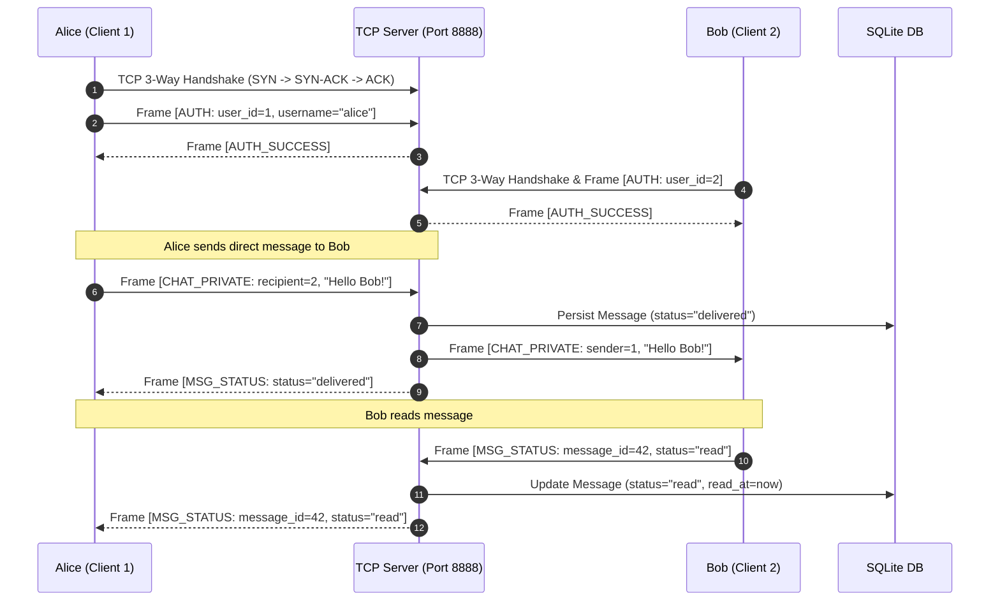
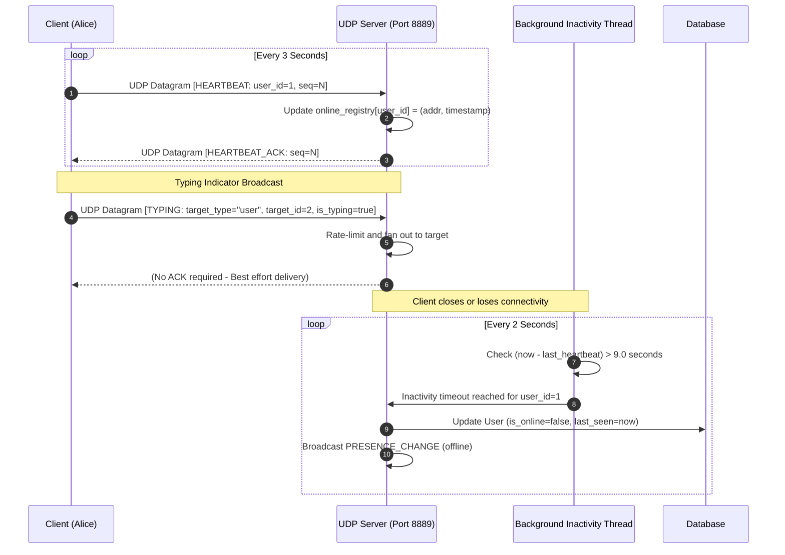
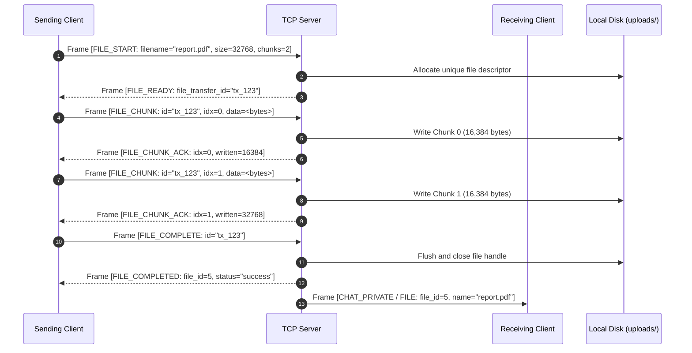

# NetConnect System Architecture Documentation

NetConnect is a multi-client real-time communication platform built to demonstrate transport-layer and application-layer Computer Networks concepts using Python's standard `socket` module.

---

## 1. High-Level Architectural Overview

NetConnect adheres to a hybrid client-server topology designed to bridge low-level networking primitives with modern web clients:

1. **Web Frontend (React / Vite / Tailwind)**: Delivers an interactive user experience in web browsers. Communicates with the backend via REST API (JSON over HTTP) and a persistent duplex WebSocket connection.
2. **WebSocket Gateway**: Acts as an application-layer proxy bridge. For every connected browser user, the gateway instantiates a dedicated native TCP client socket and a UDP datagram socket, routing browser events into real socket frames.
3. **Dedicated TCP Server (`socket.AF_INET, socket.SOCK_STREAM`)**:
   - Listens on TCP Port `8888`.
   - Handles connection establishment, persistent duplex byte-streams, length-prefixed framing, reliable direct messaging, group multi-casting, offline message queueing, and chunked file transfers.
4. **Dedicated UDP Server (`socket.AF_INET, socket.SOCK_DGRAM`)**:
   - Listens on UDP Port `8889`.
   - Handles connectionless datagram processing, periodic heartbeats, real-time presence detection, timeout pruning, and lightweight typing notifications.
5. **Database Layer (SQLite + SQLAlchemy)**: Persists user identities, conversation metadata, offline message queues, file storage records, and network telemetry logs.

```mermaid
flowchart TD
    subgraph ClientLayer["Client Layer"]
        B1["Browser Client 1 (Alice)"]
        B2["Browser Client 2 (Bob)"]
        CLI["CLI Terminal Client (Charlie)"]
    end

    subgraph GatewayLayer["Application Gateway"]
        WSG["WebSocket Gateway (FastAPI /ws)"]
        REST["REST API Server (Port 5001)"]
    end

    subgraph NetworkEngines["Socket Network Engines (Python Socket)"]
        TCP["Custom TCP Server (Port 8888)\n• Length-Prefixed Framing\n• Reliable Messaging\n• Chunked File Transfer"]
        UDP["Custom UDP Server (Port 8889)\n• Connectionless Datagrams\n• Heartbeat Registry\n• Typing Notifications"]
    end

    subgraph DataStorage["Persistence Layer"]
        DB[("SQLite Database\n(SQLAlchemy ORM)")]
        FS["File Storage Directory\n(backend/uploads/)"]
    end

    B1 <-->|HTTP / WebSockets| WSG
    B2 <-->|HTTP / WebSockets| WSG
    B1 <-->|REST API| REST
    B2 <-->|REST API| REST

    WSG <-->|TCP Socket Stream| TCP
    WSG <-->|UDP Datagrams| UDP

    CLI <-->|Raw TCP Socket (8888)| TCP
    CLI <-->|Raw UDP Socket (8889)| UDP

    TCP <--> DB
    UDP <--> DB
    TCP <--> FS
```

---

## 2. TCP Communication Flow

The TCP Server maintains active socket descriptors in a thread-safe registry (`user_sockets: Dict[int, socket.socket]`). Each client socket runs in a dedicated reader thread.

### Direct Messaging Sequence Diagram



---

## 3. UDP Communication Flow

UDP is connectionless and does not require a 3-way handshake or teardown sequence. Clients periodically send heartbeat datagrams to the UDP server.



---

## 4. Chunked File Transfer Architecture

Files are transferred reliably across TCP by splitting the binary payload into configurable 16 KB chunks:



---

## 5. Concurrency and Synchronization

- **Socket Concurrency**: Handled with dedicated worker threads per connected TCP client.
- **Shared Registry Protection**: Both `TCPServer` and `UDPServer` utilize `threading.RLock()` to ensure thread-safe read/write operations when routing frames or registering active socket descriptors.
- **Asynchronous WebSocket Pumping**: The FastAPI WebSocket gateway runs asynchronous event loops using Python's `asyncio` and dispatches blocking socket I/O to background executor pools via `loop.run_in_executor()`, ensuring zero event-loop stalls.
