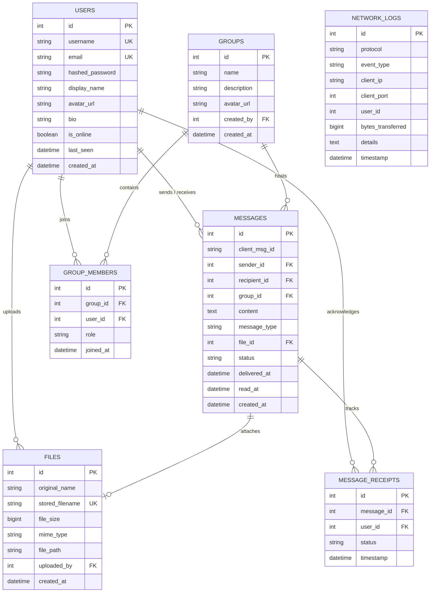

# NetConnect Database Schema Specification

NetConnect utilizes an SQLite relational database managed via the SQLAlchemy 2.0 Object-Relational Mapper (ORM).

---

## 1. Entity-Relationship Diagram (ERD)

---

## 2. Table Definitions

### Table: `users`
Stores user identities, authentication credentials, and presence metadata.
- `id`: Integer, Primary Key, Auto-increment.
- `username`: String(50), Unique, Indexed, Not Null. Lowercase username.
- `email`: String(100), Unique, Indexed, Not Null.
- `hashed_password`: String(255), Not Null. Passwords hashed using bcrypt.
- `display_name`: String(100), Not Null.
- `avatar_url`: String(255), Nullable.
- `bio`: String(255), Default status bio.
- `is_online`: Boolean, Default `False`.
- `last_seen`: DateTime (UTC).
- `created_at`: DateTime (UTC).

### Table: `groups`
Stores multi-client group chat rooms.
- `id`: Integer, Primary Key.
- `name`: String(100), Not Null.
- `description`: Text, Nullable.
- `avatar_url`: String(255), Nullable.
- `created_by`: Integer, Foreign Key -> `users.id`.
- `created_at`: DateTime (UTC).

### Table: `group_members`
Association table linking users to groups with permission roles.
- `id`: Integer, Primary Key.
- `group_id`: Integer, Foreign Key -> `groups.id` (Cascade on delete).
- `user_id`: Integer, Foreign Key -> `users.id`.
- `role`: String(20), Default `'member'` (`'admin'` or `'member'`).
- `joined_at`: DateTime (UTC).

### Table: `messages`
Stores direct messages and group room messages with status tracking.
- `id`: Integer, Primary Key, Auto-increment.
- `client_msg_id`: String(100), Indexed. Prevents duplication.
- `sender_id`: Integer, Foreign Key -> `users.id`.
- `recipient_id`: Integer, Foreign Key -> `users.id`, Nullable (Null for group chat).
- `group_id`: Integer, Foreign Key -> `groups.id`, Nullable (Null for direct chat).
- `content`: Text, Not Null.
- `message_type`: String(20), Default `'text'` (`'text'`, `'file'`, `'system'`).
- `file_id`: Integer, Foreign Key -> `files.id`, Nullable.
- `status`: String(20), Default `'sent'` (`'sent'`, `'delivered'`, `'read'`).
- `delivered_at`: DateTime (UTC), Nullable.
- `read_at`: DateTime (UTC), Nullable.
- `created_at`: DateTime (UTC), Indexed.

### Table: `files`
Stores metadata for files uploaded or transferred over TCP.
- `id`: Integer, Primary Key.
- `original_name`: String(255), Not Null.
- `stored_filename`: String(255), Unique, Not Null.
- `file_size`: BigInteger (Bytes), Not Null.
- `mime_type`: String(100), Default `'application/octet-stream'`.
- `file_path`: String(500), Not Null.
- `uploaded_by`: Integer, Foreign Key -> `users.id`.
- `created_at`: DateTime (UTC).

### Table: `network_logs`
Stores low-level transport events for auditing and the network monitoring dashboard.
- `id`: Integer, Primary Key.
- `protocol`: String(10), `'TCP'` or `'UDP'`.
- `event_type`: String(50), e.g. `'CONNECT'`, `'DISCONNECT'`, `'MSG_RELAY'`, `'HEARTBEAT'`, `'TIMEOUT'`, `'FILE_CHUNK'`.
- `client_ip`: String(50), Nullable.
- `client_port`: Integer, Nullable.
- `user_id`: Integer, Nullable.
- `bytes_transferred`: BigInteger, Default 0.
- `details`: Text, Nullable.
- `timestamp`: DateTime (UTC), Indexed.
